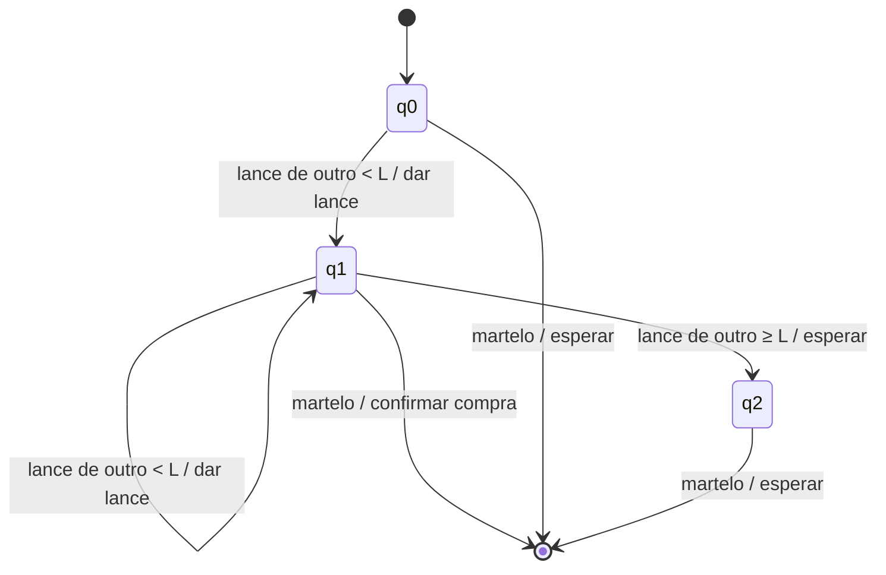

# Atividade — Agentes Inteligentes

**Aluno:** Pedro Henrique Sipriano Cavalcante - RGM: 39439526
**Curso:** Ciência da Computação — UDF
**Disciplina:** Linguagens Formais e Autômatos — Profa. Kadidja Valéria
**Data:** 20/10/2026

---

## Exercício 2.3 — Verdadeiro ou falso

A ideia que guia todas as respostas: um agente racional escolhe a ação que **espera** dar o melhor resultado, com base no que percebeu até agora. Ele não precisa ser onisciente nem acertar sempre.

**a) Agente com percepção parcial não pode ser perfeitamente racional — Falso.**
Racionalidade é avaliada pelo que o agente consegue perceber, não pelo mundo inteiro. O aspirador do livro só vê o quadrado onde está e, mesmo assim, é racional nas condições da Seção 2.2.1. Como a frase diz "não pode", um contraexemplo já basta.

**b) Existem ambientes em que nenhum agente reativo puro age racionalmente — Verdadeiro.**
Quando a decisão certa depende de algo que já passou, só olhar a percepção atual não resolve. Exemplo: um aspirador sem sensor de posição, ao ver "Limpo", não sabe para que lado ir e pode ficar em loop. Com memória, o problema some.

**c) Existe um ambiente em que todo agente é racional — Verdadeiro.**
Basta um ambiente em que todas as ações dão o mesmo resultado. Por exemplo, se só existe uma ação possível ou se a pontuação é sempre zero, qualquer agente faz o melhor possível.

**d) A entrada do programa é a mesma da função de agente — Falso.**
A função recebe o histórico completo de percepções. O programa recebe só a percepção atual e, se precisar do histórico, tem que guardar sozinho, como faz o agente dirigido por tabela da Figura 2.7.

**e) Toda função de agente pode ser implementada por programa + máquina — Falso.**
Algumas funções não são computáveis, como uma que precise decidir o problema da parada. Outras até seriam, mas não cabem em nenhuma máquina real: a tabela do xadrez teria mais de 10¹⁵⁰ entradas.

**f) Um agente que escolhe ações ao acaso pode ser racional em um ambiente determinístico — Verdadeiro.**
Se todas as ações levam ao mesmo desempenho, escolher no aleatório não perde nada. Um mundo do aspirador já limpo e sem custo de movimento é um exemplo.

**g) Um mesmo agente pode ser perfeitamente racional em dois ambientes diferentes — Verdadeiro.**
Se a diferença entre os ambientes não muda qual é a melhor ação, o mesmo agente serve nos dois. O aspirador reativo continua racional se mudarmos só a cor do piso ou onde a sujeira começa.

**h) Todo agente é racional em um ambiente não observável — Falso.**
Mesmo sem sensores, existem estratégias melhores que outras. Um aspirador "cego" que faz *Aspirar, Direita, Aspirar, Esquerda, Aspirar* sempre limpa tudo. Um que fica parado, não.

**i) Um jogador de pôquer perfeitamente racional nunca perde — Falso.**
O pôquer tem cartas escondidas e sorte. O agente pode tomar a melhor decisão e mesmo assim perder a mão na última carta. Racionalidade melhora o resultado médio, não garante vitória.

---

## Exercício 2.4 — PEAS e classificação dos ambientes

Em cada caso, deixo claro quem é o agente e as hipóteses que assumi, porque a classificação muda conforme essas escolhas.

### 1. Futebol
**Agente:** um jogador (ou robô) de um time.

- **P:** gols feitos, gols evitados, vitória, poucas faltas.
- **E:** campo, bola, companheiros, adversários, árbitro.
- **A:** pernas, cabeça e corpo para chutar, correr e cabecear.
- **S:** visão, audição e noção do próprio corpo.

**Classificação:** parcialmente observável (não vê o campo todo), multiagente (coopera com o time e compete com o rival), estocástico, sequencial, dinâmico, contínuo e conhecido.

### 2. Exploração de Titã (hipotética)
**Agente:** um robô submarino autônomo. Está longe demais para ser controlado da Terra em tempo real.

- **P:** área mapeada, amostras coletadas, dados enviados, sobreviver gastando pouca energia.
- **E:** oceano sob o gelo, correntes, química pouco conhecida.
- **A:** propulsores, braço coletor, perfuratriz, transmissor.
- **S:** sonar, câmeras, sensores químicos, de temperatura e de pressão.

**Classificação:** parcialmente observável, agente único, estocástico, sequencial, dinâmico, contínuo e **desconhecido**. É o único caso desconhecido, então o robô precisa aprender explorando.

### 3. Compra de livros usados de IA na Internet
**Agente:** um software que compra em nome do usuário, dentro de um orçamento.

- **P:** conseguir os livros certos, pagar pouco (preço + frete), bom estado, entrega rápida.
- **E:** sites, vendedores, outros compradores, sistemas de pagamento.
- **A:** buscar, clicar, preencher formulários, finalizar pedidos (saídas digitais).
- **S:** conteúdo das páginas, resultados de busca, e-mails de confirmação (entradas digitais).

**Classificação:** parcialmente observável, multiagente, estocástico (estoque e preço mudam), sequencial (o orçamento gasto limita as próximas compras), dinâmico, discreto e conhecido.

### 4. Partida de tênis
**Agente:** um jogador em partida de simples.

- **P:** ganhar pontos, sets e a partida; errar pouco.
- **E:** quadra, rede, bola, adversário, vento.
- **A:** pernas, braço e raquete.
- **S:** visão, audição e noção do corpo.

**Classificação:** parcialmente observável (não dá para ver o efeito da bola nem a intenção do rival), multiagente competitivo, estocástico, sequencial, dinâmico, contínuo e conhecido.

### 5. Tênis contra a parede
**Agente:** um jogador treinando sozinho.

- **P:** quantidade de rebatidas seguidas e precisão no alvo.
- **E:** parede, piso, bola.
- **A:** pernas, braço e raquete.
- **S:** visão, audição e noção do corpo.

**Classificação:** completamente observável (aproximadamente), agente único (a parede só segue a física), estocástico, sequencial, dinâmico, contínuo e conhecido.

### 6. Salto em altura
**Agente:** o atleta durante uma tentativa.

- **P:** passar o sarrafo sem derrubar, alcançar a maior altura, não se machucar.
- **E:** pista, sarrafo, colchão, clima.
- **A:** pernas para a corrida e a impulsão; tronco e braços para a rotação no ar.
- **S:** visão, equilíbrio e noção do corpo.

**Classificação:** completamente observável (aproximadamente), agente único (durante o salto ninguém interfere), estocástico, sequencial (cada fase depende da anterior), dinâmico, contínuo e conhecido.

### 7. Leilão de um item
**Agente:** um licitante automático num leilão com lances abertos e crescentes. O usuário define um valor máximo.

- **P:** arrematar pagando o mínimo possível, sem passar do limite.
- **E:** leiloeiro, outros licitantes, item, regras.
- **A:** dar lance, esperar, confirmar a compra.
- **S:** lance atual, avisos do leiloeiro, tempo restante.

**Classificação:** parcialmente observável (os lances são públicos, mas o limite dos outros é segredo), multiagente competitivo, determinístico (o livro desconsidera a incerteza que vem só de outros agentes), sequencial, dinâmico, discreto e conhecido.

### Resumo

| Ambiente | Observável | Agentes | Determ. | Episódico | Estático | Discreto | Conhecido |
|---|---|---|---|---|---|---|---|
| Futebol | Parcial | Multi | Estocástico | Sequencial | Dinâmico | Contínuo | Sim |
| Titã | Parcial | Único | Estocástico | Sequencial | Dinâmico | Contínuo | Não |
| Livros | Parcial | Multi | Estocástico | Sequencial | Dinâmico | Discreto | Sim |
| Tênis | Parcial | Multi | Estocástico | Sequencial | Dinâmico | Contínuo | Sim |
| Tênis na parede | Completo | Único | Estocástico | Sequencial | Dinâmico | Contínuo | Sim |
| Salto em altura | Completo | Único | Estocástico | Sequencial | Dinâmico | Contínuo | Sim |
| Leilão | Parcial | Multi | Determinístico | Sequencial | Dinâmico | Discreto | Sim |

### Comparações

**Tênis contra pessoa × contra a parede:** a diferença é ter ou não outro agente. O adversário quer ganhar justamente o ponto que eu perco, e eu não sei o que ele pretende fazer. A parede só devolve a bola seguindo a física, então dá para prever o retorno pelo que se vê.

**Informações incompletas na compra de livros:** o agente não sabe o estado real do livro, se o vendedor é confiável, se o estoque está atualizado, qual é a edição exata nem se há ofertas melhores em outros sites. Por isso faz sentido ele pesquisar avaliações e comparar sites antes de comprar.

**Outros agentes no futebol e no leilão:** no futebol há cooperação com o próprio time e competição com o adversário, então comunicação passa a ser importante. No leilão a competição é pura: cada lance de outra pessoa sobe o preço e diminui o ganho do agente.

---

## Exercício 2.5 — Definições

**Agente:** algo que percebe o ambiente por sensores e age sobre ele por atuadores.
*Ex.:* um robô aspirador.

**Função de agente:** a "regra matemática" que diz qual ação tomar para cada histórico de percepções possível.
*Ex.:* a tabela da Figura 2.3.

**Programa de agente:** o código que implementa essa função na prática. Recebe só a percepção atual.
*Ex.:* o pseudocódigo do aspirador da Figura 2.8.

**Racionalidade:** escolher a ação que se espera dar o melhor desempenho com o que se sabe até o momento. Não exige acertar sempre.
*Ex.:* olhar para os dois lados antes de atravessar a rua.

**Autonomia:** agir com base na própria experiência, e não só no que o projetista programou.
*Ex.:* um aspirador que aprende onde costuma aparecer mais sujeira.

**Agente reativo:** decide só pela percepção atual, usando regras do tipo "se… então".
*Ex.:* "se o carro da frente frear, freie".

**Agente baseado em modelo:** guarda um estado interno sobre o que não está vendo agora, atualizado conforme o mundo muda.
*Ex.:* um táxi que lembra que tem um carro no ponto cego.

**Agente baseado em objetivos:** escolhe ações pensando em chegar a uma meta.
*Ex.:* um GPS traçando rota até o destino.

**Agente baseado em utilidade:** não basta chegar ao objetivo, ele compara o quão bom é cada resultado e escolhe o melhor.
*Ex.:* um app de rotas que pondera tempo, pedágio e trânsito.

**Agente com aprendizagem:** melhora com a experiência, a partir de um crítico que avalia o desempenho e de um componente que sugere novas tentativas.
*Ex.:* um programa de xadrez que ajusta a estratégia depois de cada partida.

---

## Síntese com autômatos

**Cenário:** o licitante automático do leilão (caso 7), com valor máximo `L`. Escolhi esse caso por ser discreto, o que facilita modelar como autômato.

**Estados internos**
- **q0 — Fora da liderança:** o último lance foi de outra pessoa.
- **q1 — Liderando:** o último lance foi meu.
- **q2 — Desisti:** o preço passou do meu limite.

**Percepções**
- Outro deu lance abaixo de `L`.
- Outro deu lance igual ou acima de `L`.
- Martelo: o leilão acabou.

**Ações**
- Dar lance.
- Esperar.
- Confirmar a compra.

**Regras de transição**
1. Em **q0**, se outro der lance abaixo de `L` → **dar lance** e ir para **q1**.
2. Em **q1**, se outro der lance acima de `L` → **esperar** e ir para **q2**.

**Como o estado guarda o passado:** quando o martelo bate, essa percepção sozinha não diz se ganhei. Quem sabe disso é o estado: estar em q1 significa que o último lance foi meu. Ou seja, o estado resume o histórico sem precisar guardar todos os lances.

**Limitação:** o modelo tem poucos estados e um limite fixo. Ele não aprende, não percebe quantos concorrentes ainda estão ativos e ignora detalhes como lances no último segundo ou outros tipos de leilão.

---

## Referências

- RUSSELL, Stuart; NORVIG, Peter. Agentes inteligentes. In: **Inteligência artificial**. 3. ed. Rio de Janeiro: Elsevier, 2013. cap. 2.
